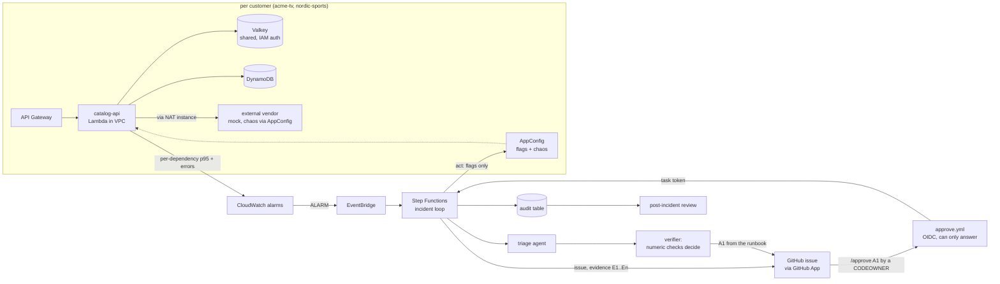

# Showrunner

Operations for many customers' streaming services, on one Free-plan AWS account:

- **a new customer environment is one YAML file** in a pull request
- **every dependency is measured separately** (cache, database, external vendor), so a
  slow vendor can't hide behind a "the cache is slow" dashboard
- **incidents are triaged by agents that must cite evidence and survive a verifier**,
  then fixed with **one human approval**, through runtime config, with no deploy
- **CI/CD where a malicious dependency finds nothing to steal**: OIDC only, pinned
  everything, egress blocked

The problems this answers are public ones, listed with sources in
[docs/problem-map.md](docs/problem-map.md). Customers are fictional: `acme-tv` and
`nordic-sports`.

## What happens in an incident (built, run on 17/11/2026)



Measured on `dev` with scenario S1 (the vendor gets 1.5 s slower for `acme-tv`):

| Step | Time | Run |
|---|---|---|
| chaos on -> vendor alarm | 66 s | 17/11/2026 23:09:57 -> 23:11:03 UTC |
| alarm -> GitHub issue | 3 s | 23:11:06 |
| second alarm (API p95) joined to the same issue, not a new one | +37 s | 23:11:40 |
| loop start -> analysis + proposal A1 posted | 10.7 s | 23:17:13 -> 23:17:24 (re-run after a fix, below) |
| flag `vendor_fallback` deployed (lane 1, no deploy) | 15 s | 17/11/2026 22:20, day-1 run |
| first fallback request after the flag | 17 s | same run; recs p95 on fallback 12.3 ms (52 requests) |

The analysis named the vendor (1,633 ms vs an expected 250 ms) and **ruled out the cache
with numbers**: Valkey at 2.1 ms client-side, 1,238 µs server-side p99, 0.1% of the API's
p95. Bedrock isn't enabled on this new account yet, so triage ran on deterministic rules
and the issue says so; the verifier's verdicts are numeric checks either way.

**Not yet run end to end:** `/approve A1` -> act -> recovery check -> post-incident
review on GitHub. Every step is unit-tested (including act refusing anything but the
approved proposal), and the approval needs a human, on purpose.

**The first real run got it wrong, and that's in the record.** Traffic had started
only ~1.5 minutes before the chaos, so the "baseline" was a single minute: the first
one, inflated by cold starts (vendor p95 ~1.6 s for *both* customers, including the
untouched one). Against it the slow vendor looked 1.2x slower and was refuted, and an
hour-old, already-reverted rehearsal change was counted as a cause. Fixed by building
the baseline only from minutes before the alarm window, needing at least three of them
(their median absorbs a cold minute) or else using the documented expected p95, and by
counting a change only if it's recent and still in effect. Shipped through lane 2 in
under a minute, with regression tests built from the real numbers.

## How it's built

| Area | What | Why (ADR) |
|---|---|---|
| Compute | Lambda + API Gateway per customer; one VPC per env with a NAT **instance** | [0001](docs/adr/0001-serverless-core-no-eks.md) no EKS, [0003](docs/adr/0003-nat-instance.md) ~$10/month vs ~$33 |
| Customers | `platform/customers/<name>/<env>.yaml` -> one module, own state, IAM, tags, cache user | [0002](docs/adr/0002-one-account.md) |
| Cache | ElastiCache Serverless Valkey, shared per env, per-customer IAM-authenticated users with key-prefix ACLs | [0006](docs/adr/0006-shared-cache-iam-auth.md) |
| Changes | three lanes: AppConfig (seconds) -> app code (`sr deploy`) -> Terraform (only the stacks touched) | [0004](docs/adr/0004-three-change-lanes.md) |
| Incidents | Step Functions loop, five functions with five roles; only `act` can change anything, and only flags | [0005](docs/adr/0005-agents-propose-humans-approve.md), [0008](docs/adr/0008-approver-role-scope.md) |
| Agents | `ops/agents/*.md`: the instruction file **is** the IAM policy (Terraform reads it) | [ops/agents](ops/agents/README.md) |
| Runbooks | one per alarm; front matter lists the only actions the loop may propose | [ops/runbooks](ops/runbooks/README.md) |
| CI/CD | OIDC per workflow (no keys), SHA-pinned actions, harden-runner egress block, plan comments with policy checks, prod-role stacks behind a reviewer | [0009](docs/adr/0009-oidc-immutable-subject.md) |
| Guardrails | conftest never-create list (no EKS, NAT gateway, RDS, interface endpoints...), tag policy, checkov, tflint, zizmor, gitleaks | [platform/policy](platform/policy) |

Operator CLI: `./sr preflight` (is the demo ready?), `./sr status`, `./sr config set`,
`./sr deploy <service>`, `./sr demo traffic|watch|s1|reset`, `./sr snapshot`.

## Cost

Model from the AWS Price List API (18/11/2026): **about $17–22/month** for the core,
mostly the NAT instance + its IPv4 (~$10) and the Valkey minimum (~$6). The incident
loop costs ~$0.0015 per incident. Budgets: $60/month and $5 for Bedrock, with anomaly
detection. Details: [docs/COST.md](docs/COST.md).

## Built vs roadmap

Built (the 2-day core): two customers on `dev`, per-dependency metrics and alarms,
runbooks, the three change lanes, scenario S1 with a recorded fallback
([docs/demo/S1.md](docs/demo/S1.md)), the incident loop up to the approval, CI/CD with
plan comments, `sr preflight`, the supply-chain demo (PR #4: a malicious dependency finds
nothing and its call home is blocked, [record](docs/demo/supply-chain.md)), and the
incident run record ([docs/demo/incident.md](docs/demo/incident.md)).

**Not built yet** (in order, [docs/ROADMAP.md](docs/ROADMAP.md)): customer pages on
CloudFront (code and tests done; waiting for AWS to verify the new account for
CloudFront), the self-service readiness gate, PR review agents, network case files
(S3/S4), canary deploys and container images with provenance, then prod, SLO burn-rate
alarms, load tests that find the breaking point, cost reports and an MCP server.

## Repo map

```
platform/        Terraform: bootstrap (CI roles, state), shared/<env>, customers/<name>/<env>, ops-core, modules, policy
services/        catalog-api, vendor-mock (Lambda, Python 3.12)
ops/             agents (instruction files), runbooks, incident (the loop), lib, scenarios
tools/           sr (operator CLI), build (reproducible zips), ci (changed stacks, plan comments, approve)
docs/            ADRs, cost, problem map, roadmap, demo script + recorded fallbacks
tests/           pytest + moto: services, ops, CI tools, sr (IAM guardrails: platform/bootstrap/tests)
```
