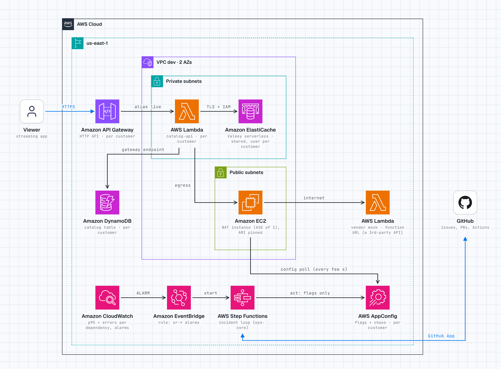
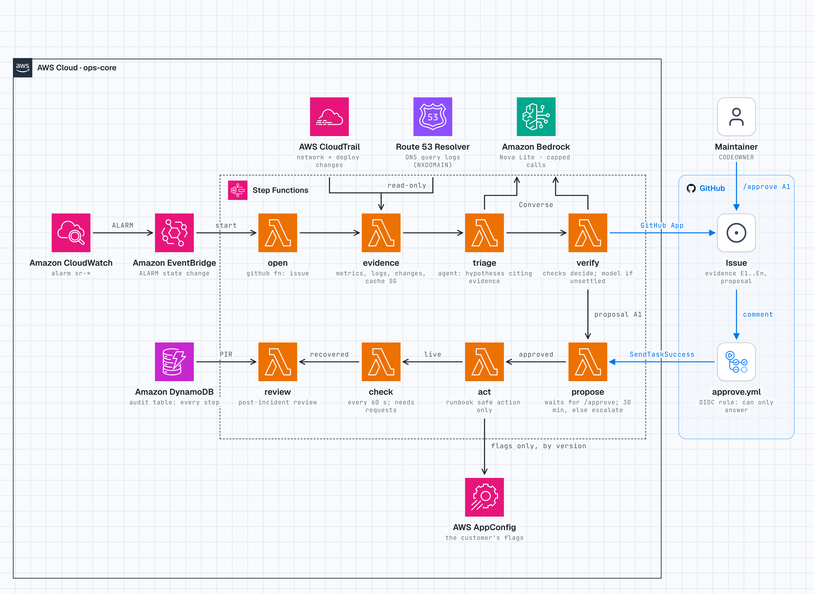

# Showrunner

Operations for many customers' streaming services, on one Free-plan AWS account:

- **a new customer environment is one YAML file** in a pull request
- **every dependency is measured separately** (cache, database, external vendor), so a
  slow vendor can't hide behind a "the cache is slow" dashboard
- **incidents are triaged by agents that must cite evidence and survive a verifier**,
  then fixed with **one human approval**, through runtime config, with no deploy
- **CI/CD where a malicious dependency finds nothing to steal**: OIDC only, pinned
  everything, egress blocked

The problems this answers are public ones, listed with sources in
[docs/problem-map.md](docs/problem-map.md). Customers are fictional: `acme-tv` and
`nordic-sports`.

## The platform

<picture>
  <source media="(prefers-color-scheme: dark)" srcset="docs/diagrams/01-platform-dark.png">
  
</picture>

One Free-plan account, `us-east-1`, the `dev` environment. Shared per environment: the VPC, the NAT instance (ADR 0003), the cache and the vendor mock. Per customer, from one YAML file: the API, the function, the table, the config and the alarms.

## What happens in an incident (built, run on 17/11/2026)

<picture>
  <source media="(prefers-color-scheme: dark)" srcset="docs/diagrams/02-incident-loop-dark.png">
  
</picture>

Five functions with five IAM roles; only `act` can change anything, and only flags. All five diagrams, with the HTML they're rendered from: [docs/diagrams](docs/diagrams/README.md).

Measured on `dev` with scenario S1 (the vendor gets 1.5 s slower for `acme-tv`), end to
end on **18/11/2026**, issue [#6](https://github.com/Anshul-exe/showrunner/issues/6)
(times from the alarm at 10:10:03 UTC; [full record](docs/demo/incident.md)):

| Step | Time | |
|---|---|---|
| chaos on -> vendor alarm | 113 s | AppConfig `chaos` #13 started 10:08:10 |
| alarm -> GitHub issue | +4 s | |
| alarm -> analysis + proposal A1 | +13 s | model triage (Nova Lite) + verifier |
| a human comments `/approve A1` | +85 s | the only wait that's a person |
| alarm -> fallback flag live | **+152 s** | approve.yml 59 s (two jobs on fresh runners), AppConfig #14 live in 6.4 s, no deploy |
| alarm -> recovered | **+334 s** | API p95 1,620 ms -> 32 ms (two clean minutes in a row) |
| post-incident review posted, issue closed | +334 s | from the audit trail |

The analysis named the vendor (1,612 ms vs 110 ms before) and **ruled out the cache
with numbers**: Valkey at 2.4 ms client-side, 1,025 µs server-side p99, 0.1% of the
API's p95; DynamoDB at 0.6%. Every step, the approval and the change are in the issue
and the audit table. `./sr demo s1 stop` then reset chaos (#15) and the flag (#16).

The first S1 runs (17/11/2026, issues #1 and #2) measured alarm -> issue 3 s and
start -> proposal 10.7 s, and escalated on purpose when nobody approved within 30 min.

**The first real run got it wrong, and that's in the record.** Traffic had started
only ~1.5 minutes before the chaos, so the "baseline" was a single minute: the first
one, inflated by cold starts (vendor p95 ~1.6 s for *both* customers, including the
untouched one). Against it the slow vendor looked 1.2x slower and was refuted, and an
hour-old, already-reverted rehearsal change was counted as a cause. Fixed by building
the baseline only from minutes before the alarm window, needing at least three of them
(their median absorbs a cold minute) or else using the documented expected p95, and by
counting a change only if it's recent and still in effect. Shipped through lane 2 in
under a minute, with regression tests built from the real numbers.

## How it's built

| Area | What | Why (ADR) |
|---|---|---|
| Compute | Lambda + API Gateway per customer; one VPC per env with a NAT **instance** | [0001](docs/adr/0001-serverless-core-no-eks.md) no EKS, [0003](docs/adr/0003-nat-instance.md) ~$10/month vs ~$33 |
| Customers | `platform/customers/<name>/<env>.yaml` -> one module, own state, IAM, tags, cache user | [0002](docs/adr/0002-one-account.md) |
| Cache | ElastiCache Serverless Valkey, shared per env, per-customer IAM-authenticated users with key-prefix ACLs | [0006](docs/adr/0006-shared-cache-iam-auth.md) |
| Changes | three lanes: AppConfig (seconds) -> app code (`sr deploy`) -> Terraform (only the stacks touched) | [0004](docs/adr/0004-three-change-lanes.md) |
| Incidents | Step Functions loop, five functions with five roles; only `act` can change anything, and only flags | [0005](docs/adr/0005-agents-propose-humans-approve.md), [0008](docs/adr/0008-approver-role-scope.md) |
| Agents | `ops/agents/*.md`: the instruction file **is** the IAM policy (Terraform reads it) | [ops/agents](ops/agents/README.md) |
| Runbooks | one per alarm; front matter lists the only actions the loop may propose | [ops/runbooks](ops/runbooks/README.md) |
| CI/CD | OIDC per workflow (no keys), SHA-pinned actions, harden-runner egress block, plan comments with policy checks, prod-role stacks behind a reviewer | [0009](docs/adr/0009-oidc-immutable-subject.md) |
| Guardrails | conftest never-create list (no EKS, NAT gateway, RDS, interface endpoints...), tag policy, checkov, tflint, zizmor, gitleaks | [platform/policy](platform/policy) |

Operator CLI: `./sr preflight` (is the demo ready?), `./sr status`, `./sr config set`,
`./sr deploy <service>`, `./sr demo traffic|watch|s1|reset`, `./sr snapshot`.

## Cost

Model from the AWS Price List API (18/11/2026): **about $17–22/month** for the core,
mostly the NAT instance + its IPv4 (~$10) and the Valkey minimum (~$6). The incident
loop costs ~$0.0015 per incident. Budgets: $60/month and $5 for Bedrock, with anomaly
detection. Details: [docs/COST.md](docs/COST.md).

## Built vs roadmap

Built (the 2-day core): customers on `dev` (a third, `lumen-kids`, added by PR and
applied by CI), per-dependency metrics and alarms, runbooks, the three change lanes,
scenario S1 with a recorded fallback ([docs/demo/S1.md](docs/demo/S1.md)), the incident
loop end to end (alarm, issue, proposal, human `/approve`, mitigation, recovery, PIR:
[docs/demo/incident.md](docs/demo/incident.md)), Bedrock triage with a verifier, CI/CD
with plan comments and an apply-role access check, `sr preflight`, and the supply-chain
demo (PR #4: a malicious dependency finds nothing and its call home is blocked,
[record](docs/demo/supply-chain.md)).

Tier 2 so far: the self-service readiness gate (built); customer pages on CloudFront
(code and tests done, off until AWS verifies the account for CloudFront); PR review
agents (`iac-security` + verifier, [ADR 0013](docs/adr/0013-review-agents.md)): built
and run on real PRs since 18/11/2026 (#10 seeded: a confirmed high, the gate failed,
`accept-risk` with an audit row; #11-#13: gate passed)
([docs/demo/review-agents.md](docs/demo/review-agents.md)).
Network case files ([ADR 0014](docs/adr/0014-network-evidence.md)): the incident loop's
evidence now includes the cache's security-group rule vs Terraform, CloudTrail network
changes, flow-log REJECTs, Resolver NXDOMAINs and a capped Reachability Analyzer check.
**S3** (a rule revoked by hand) drilled on dev twice on 18/11/2026
([case file](docs/demo/case-files/S3.md)): the first drill found a real bug (a cache
outage became a full outage: 503 after 8.8 s), fixed with a circuit breaker; the second
served every request. The Terraform half (Resolver logs, evidence IAM, flags schema) was applied through CI
on 19/11/2026. **S4** (a flags change with a typo'd vendor host) ran through the deployed
loop on 19/11/2026 ([case file](docs/demo/case-files/S4.md)): the config change was
confirmed by the Resolver logs (NXDOMAIN) 18 s after the alarm; after `/approve` the loop
rolled back exactly that deployment (live 312 s after the alarm) and the vendor's errors
went to 0 the next minute (issue #19). The first run (#17) escalated with no approval and
changed nothing, and found that AppConfig's rollback monitor blocked every fix and caught
nothing: removed ([ADR 0017](docs/adr/0017-no-appconfig-rollback-monitor.md)).
Canary deploys ([ADR 0016](docs/adr/0016-lane-2-canary.md)): CodeDeploy needs a paid
AWS plan, so the deploy tool does what CodeDeploy does: a weighted Lambda alias (10% for
5 minutes), rollback driven by the API's 5xx and latency alarms, and re-publishing the
good build after a rollback. CI deploys only a zip it attested on `main`, by digest. First real run on dev on 19/11/2026: three customers
promoted after 320-340 s. **S2** (a build that fails 20% of searches) on the same day:
10% of requests reached it (measured: 80 of 898), `canary-errors` rolled it back after
154 s, 18 failed searches in all (2% of searches for 2.5 minutes), the old version served
2,101 requests with 0 errors ([record](docs/demo/canary.md)).

**Not built yet** (in order, [docs/ROADMAP.md](docs/ROADMAP.md)): container images (by digest, with provenance), then prod, SLO burn-rate
alarms, load tests that find the breaking point, cost reports, an MCP server, and the
other four review specialists.

## Repo map

```
platform/        Terraform: bootstrap (CI roles, state), shared/<env>, customers/<name>/<env>, ops-core, modules, policy
services/        catalog-api, vendor-mock (Lambda, Python 3.12)
ops/             agents (instruction files), runbooks, incident (the loop), lib, scenarios
tools/           sr (operator CLI), build (reproducible zips), ci (changed stacks, plan comments, approve)
docs/            ADRs, diagrams, cost, problem map, roadmap, demo script + recorded fallbacks
tests/           pytest + moto: services, ops, CI tools, sr (IAM guardrails: platform/bootstrap/tests)
```
