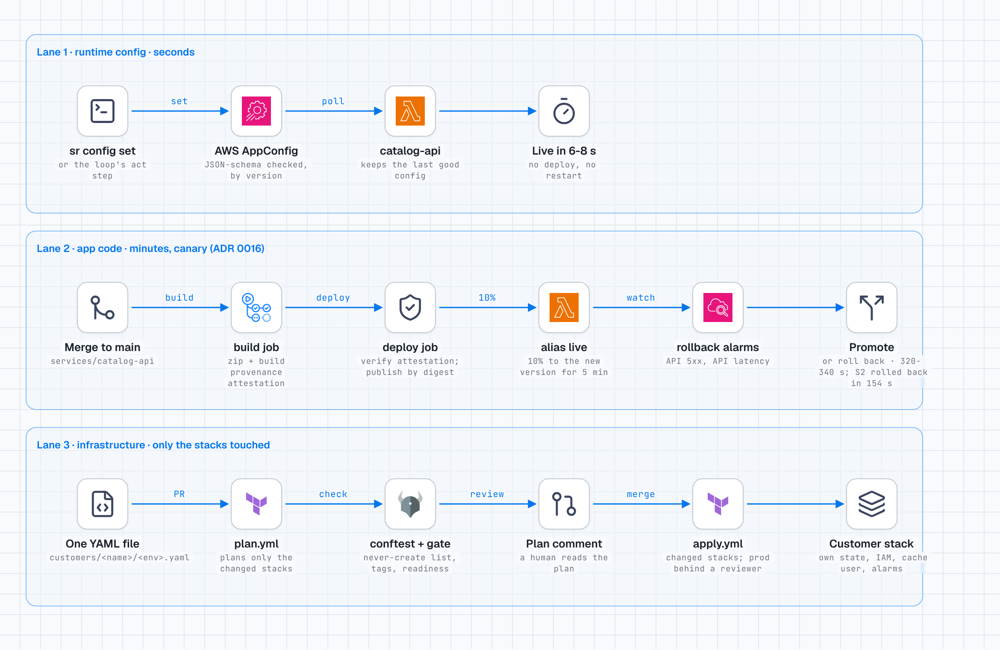

# 0004: Three change lanes

Date: 18/11/2026. Status: accepted (core version; tier 2 adds the canary).

## Context

P5 (docs/problem-map.md): AI-generated insight is slow to act on because every change
becomes "a ticket, build, test, deploy", and capabilities should change "without a
redeployment". A small change should never redeploy everything.

## Decision

Every change goes through the fastest lane that can carry it:

| Lane | What | How | Typical time |
|---|---|---|---|
| 1. Runtime | flags, TTLs, chaos, (later) event mode, vendor URL | AppConfig hosted config, JSON-schema validated, deployed with `sr-<env>-runtime` (immediate + 1-minute bake; no automatic rollback since 19/11/2026: ADR 0017). catalog-api polls every 15 s. | seconds to go live, no deploy |
| 2. App code | `services/*` | `./sr deploy <service>`: reproducible zip, `UpdateFunctionCode`, publish a version, move alias `live`. Rollback = move `live` back (printed by the deploy). | ~6 s per function |
| 3. Infrastructure | `platform/*` | Terraform, only the stacks a change touches (`tools/ci/changed_stacks.py`): plan on the PR, apply on merge. | one customer stack plans in ~22 s |

Lanes don't fight:
- Terraform creates a function from the zip, then ignores the code
  (`ignore_changes = [filename, source_code_hash]`).
- The `live` alias follows the latest published version. After a lane-2 deploy,
  `terraform plan` shows **no changes** (checked 18/11/2026: acme-tv `live` v2 -> v3 by
  `sr deploy`, then a plan: "No changes"). A Terraform config change (memory,
  environment) publishes a version and moves `live` in the same apply.
- AppConfig deployments made at runtime are never in Terraform state; Terraform only
  owns the default version.

Why an in-code AppConfig client instead of the AWS AppConfig Lambda extension: the
extension is a layer pinned by account, version and architecture; the client is ~50
lines (`services/shared/srkit/appconfig.py`), unit-tested, and behaves the same (poll
interval, keep the last good config on errors).

## Diagram

Lane 2 as built is the canary of [ADR 0016](0016-lane-2-canary.md).

## Consequences

- In the core, lane 2 moves `live` all at once and runs from the operator's machine.
  Tier 2: container image by digest with build provenance, `build-deploy.yml`, and a
  CodeDeploy canary on `live` with alarm rollback.
- Lane 1 is where the incident loop acts (day 2): an approved action is an AppConfig
  deployment, which is why it's the fastest path from insight to mitigation.
