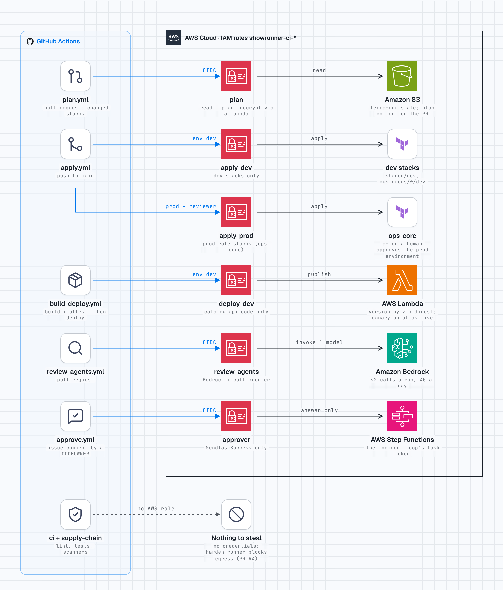

# 0009: OIDC trust uses GitHub's immutable subject format

Date: 18/11/2026. Status: accepted.

## Context

The first CI apply failed with `Not authorized to perform sts:AssumeRoleWithWebIdentity`.
Every condition in the trust policy looked right. CloudTrail's failed
`AssumeRoleWithWebIdentity` events showed the token's subject:

    repo:<owner>@<owner-id>/showrunner@<repo-id>:environment:dev

GitHub issues this **immutable subject** format for repositories created after
15/07/2026 (GitHub OIDC reference). The trust policy expected the old
`repo:<owner>/showrunner:environment:dev`. Only `sub` changes; `job_workflow_ref`,
`repository` and the other claims keep names, and the IDs are also in `repository_id` and
`repository_owner_id`.

## Decision

Match the immutable format (bootstrap `sub_prefix`, new variable `github_owner_id`)
instead of switching the repo back to the legacy format. A name can be renamed or
re-registered by someone else; the numeric IDs can't. The trust policy also keeps
`repository_id` and `job_workflow_ref` conditions.

Applied in place to the seven CI roles (no role recreated; IAM guardrail tests pass).

## Diagram: which workflow gets which role

## How to debug this next time

CloudTrail records failed `AssumeRoleWithWebIdentity` calls with the token's `sub` in
`userIdentity.userName`. Compare it with the trust policy before touching anything else.
