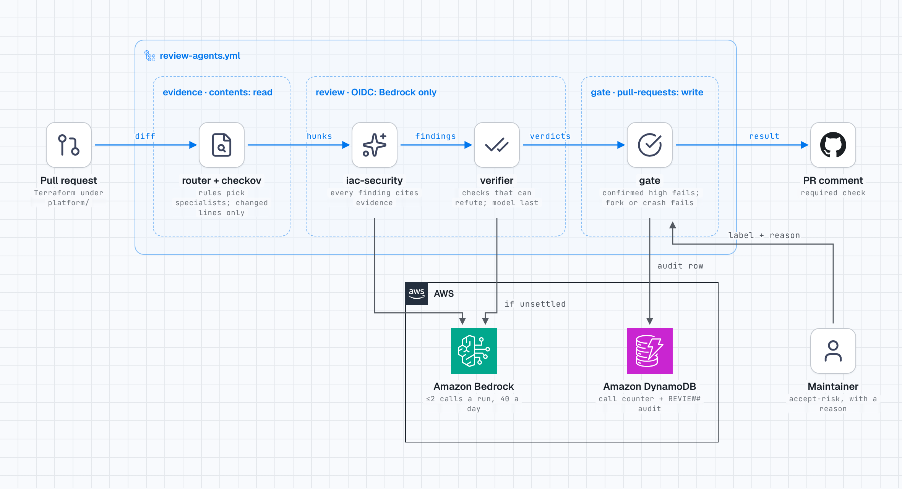

# 0013: PR review agents: one specialist, a verifier that checks before it asks

Date: 18/11/2026. Status: accepted (tier 2 item 3).

## Context

The full design (Pillar 4) is a router, five specialist reviewers and a verifier that
tries to disprove each finding, posting one PR comment and a required check. Tier 2
builds one specialist plus the verifier. A reviewer that posts false positives gets
ignored, and a model asked "is this finding right?" tends to agree, so the verifier is
the part worth getting right.

## Decision

- **Router: rules, no AI.** Changed paths pick specialists (`review/review/core.py`).
  Routed-but-not-built specialists are named in the comment, not silently skipped.
- **Specialist: `iac-security`** (Terraform under `platform/`). Its evidence is the PR's
  added/changed hunks with new-file line numbers, plus checkov's failures *on those
  lines only*. Each finding must cite evidence IDs and point at one changed line;
  uncited ones are dropped in code. If the model isn't used, checkov's failures on
  changed lines become the findings (rules mode, severity medium); whether that result
  *stands* depends on why (see "Rules mode stands only for the daily budget").
- **Verifier: code first, model second.** For each finding it runs checks that can
  *refute* it: is the line changed by this PR; for an IAM wildcard, read the actual
  statement around the line: a Deny statement, no wildcard, or an action with no IAM
  resource type (`*` is the only valid form, ADR 0008) refutes it; an Allow with a
  wildcard confirms it. Only findings the checks can't settle go to the verifier model,
  with the checks' results and the code around the line. Confirmed findings go in a
  table; refuted ones are listed collapsed with the reason, so the human sees what was
  filtered.
- **Gate** (`review/review/gate.py`, the `review-agents gate` check): a confirmed
  **high** fails it. Override: label `accept-risk` plus a reason comment by whoever
  added the label, then "Re-run failed jobs"; the gate reads labels, label events and
  comments at run time, writes the override to the audit table (below) and passes. The
  re-run is the gate job only: no model calls. No reason comment, no pass.
- **The gate always runs and fails closed.** GitHub counts a *skipped* required check as
  passing, so a gate that only ran after a successful evidence job (the first version)
  would have let a scanner crash, or any fork PR (whose evidence job is skipped), pass.
  Now `if: always()`, and in order: fork PR -> fail, "not reviewed automatically: fork
  PR"; evidence job not `success` -> fail; no Terraform -> pass; review job not
  `success` -> fail (with the reason when it's an infrastructure error, below); then
  the findings. A cancelled run (superseded by a newer push)
  still fails but doesn't overwrite the newer run's comment. Shown by a fixture run of
  the gate CLI with `--evidence-result failure` (`tests/review_agents/test_gate.py`)
  and a test that the workflow's gate is `if: always()` and needs both jobs.
- **Three jobs, three trust levels** (`review-agents.yml`):
  - `evidence` installs and runs checkov (third-party code) with `contents: read` only;
  - `review` holds the OIDC token for `showrunner-ci-review-agents` (Bedrock invoke on
    one model, and the call counter) and installs nothing: system `python3` (the
    package is standard library only) and the preinstalled AWS CLI;
  - `gate` has `pull-requests: write`, installs nothing, and gets AWS credentials only
    for the step that records an accepted override.
  Each job's harden-runner allow-list is only what that job calls.
- **Caps:** at most 2 model calls per run (`AWS_MAX_ATTEMPTS=1`, so no silent retries),
  and 40 per day through a conditional increment on `sr-ops-agent-budget` (DynamoDB,
  7-day TTL). If the counter can't be reached, no model call is made.
- **Rules mode stands only for the daily budget** (revised 19/11/2026). Every reason the
  model isn't used has a kind (`AgentUnavailable.kind`):
  - `budget`, the daily cap reached: a designed limit. The rules-mode result stands and
    the comment opens with "**Not reviewed by the model: daily budget reached.**" Rule
    findings are medium, so on their own they don't block; a human reads the diff.
  - `infra` (counter table missing or denied, Bedrock error, throttling, credentials),
    `output` (an answer that fails its schema, even through the forced tool call) and
    `cap` (the per-run cap; only a code bug reaches it): **the PR wasn't reviewed, so
    the gate fails closed.** `review run` exits 3; the review job posts its comment
    ("**Not reviewed by the model:** <stage: reason>") and fails; the gate fails with the
    reason. `accept-risk` doesn't override it: repair the cause, then "Re-run failed
    jobs", which re-runs the review job itself (that's why the review job fails, not
    only the gate). An admin can still bypass the ruleset.
  - Why: the first version fell back to rules mode for all of these. Rehearsing the
    demo PR on 18/11/2026 showed that with the counter table not yet created, the seeded
    `s3:*` on `*` would have *passed* (no model call, and rule findings are medium): a
    review that silently didn't happen looked like a clean one.
- **Contract:** instruction files `review/agents/*.md` (JSON front matter: model, token
  cap, scope, `iam`, output schema). `tests/review_agents` fails CI if the bootstrap role
  grants anything beyond the agents' `iam` plus the counter, or uses another model.

## Diagram

<picture>
  <source media="(prefers-color-scheme: dark)" srcset="../diagrams/05-review-agents-dark.png">
  
</picture>

## Consequences

- Recorded run on the seeded change (18/11/2026 11:27 UTC, local, real Bedrock): one
  model call (1,541 + 328 tokens, $0.00017), three findings: `s3:*` on `*` confirmed by
  the statement check; `states:SendTaskHeartbeat` on `*` (no resource type) and a Deny
  `*` refuted. Verifier model not needed. `docs/demo/review-agents.md`.
- **Structured output via a forced tool call** (Converse `toolConfig`, the instruction
  file's schema as the tool's input schema): plain-text JSON from Nova Lite came back
  with a misspelt key (`"severy"`) on the same day. The schema is still validated.
- The specialist's prompt asks for recall (every IAM statement with `*`); precision is
  the verifier's job. With a precision-minded prompt the model silently skipped the
  look-alikes, so the comment couldn't show what was filtered.
- The jobs run the PR's own copy of `review/` and of the workflow (that's how
  `pull_request` works), so a collaborator's PR could change the caps or the gate; the
  control for that is CODEOWNERS review of `.github/` and `review/`. The role limits the damage to Nova Lite calls (the Bedrock $5 budget alarm is
  the backstop); fork PRs get no OIDC token and are skipped.
- **`accept-risk` goes into the audit trail** (owner's decision, 18/11/2026). The review
  role may `dynamodb:PutItem` on `sr-ops-audit` only, with
  `ForAllValues:StringLike dynamodb:LeadingKeys = REVIEW#*` plus `Null = false` (without
  the Null guard, ForAllValues is true for a request with no key at all), so it can't
  write an incident row. The write uses `attribute_not_exists(pk)`: no row is
  overwritten, and a re-run finds its row and moves on. IAM has no condition key for a
  ConditionExpression, so the no-overwrite rule lives in code; IAM bounds the damage to
  `REVIEW#` rows. Row: pk `REVIEW#pr-<n>`, sk `<labelled at>#accept-risk`; who added the
  label, when, the PR, the confirmed high findings, the reason comment's link, the run;
  kept a year (incident rows: 90 days). Checked by the IAM simulator
  (`platform/bootstrap/tests/iam-guardrails.sh`: REVIEW# key allowed; an incident key,
  a mixed key list, no key, Update/Delete, another table denied) and declared in
  `review/agents/review-gate.md`, so the policy-matches-instructions test covers it,
  conditions included (a negative control, `REVIEW#*` -> `*`, fails it).

- **Known limitation (found 19/11/2026, PRs #11 and #13): the verifier reads HCL text.**
  A policy whose `resources` is a bare reference (`aws_dynamodb_table.x.arn`,
  `each.value.alarms`) parses as `resources []`, so the "is it `*`?" check passes it.
  On those PRs the verdict was right, but for the wrong reason: the references were
  scoped ARNs, which the check never saw. A real `*` written through a variable or a
  local would be missed the same way. Decided: fix in tier 3 by reading the plan JSON
  (`terraform show -json`), where references are resolved values (ROADMAP, tier 3).

## When we'd decide differently

In production: run the review code from the default branch (a `workflow_run` on the PR's
checks, never `pull_request_target`), so a PR can't change its own reviewer; add the other
four specialists; feed more checkers to the verifier (OPA over the plan JSON is more robust
than reading HCL text); and track the false-positive rate per specialist from the
refuted list.
