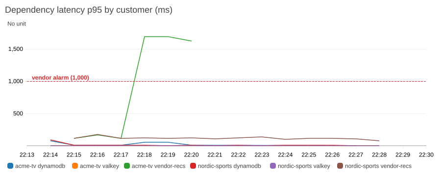
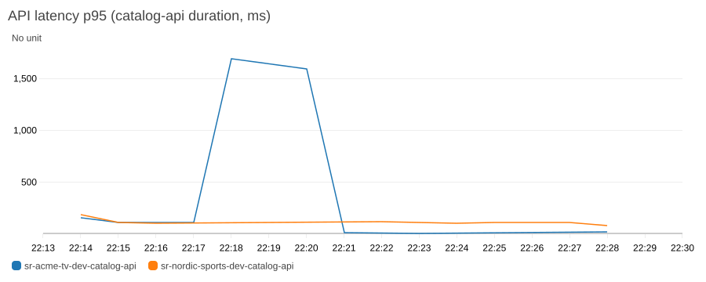
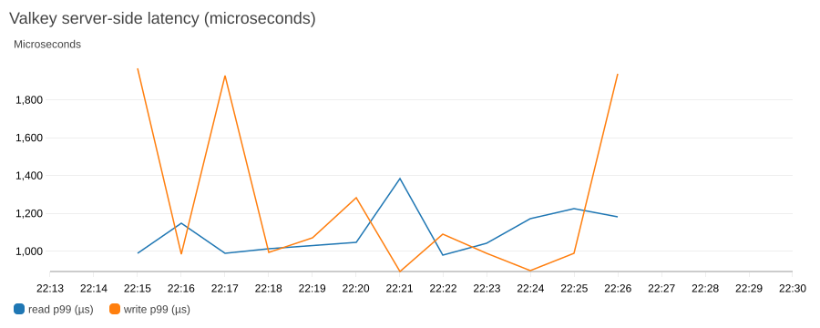

# S1 recorded run (fallback for the live demo)

Run: 17/11/2026, 22:14-22:30 UTC, `tests/e2e/s1_runtime_lane.sh` against **dev**,
3 requests/s across both customers (acme-tv + nordic-sports). Scenario:
[ops/scenarios/S1-vendor-latency.md](../../ops/scenarios/S1-vendor-latency.md).

## Timeline (from the script's output)

| UTC | Event |
|---|---|
| 22:14:53 | traffic starts; 3-minute warm-up |
| 22:17:53 | `sr-acme-tv-dev-vendor-latency` = OK |
| 22:18:09 | `./sr demo s1 start`: acme-tv vendor +1500 ms (AppConfig chaos, live in 9.1 s) |
| 22:20:09 | vendor alarm -> **ALARM, 134 s after chaos started** (SNS email with runbook link) |
| 22:20:24 | `./sr config set acme-tv flags vendor_fallback=true`: deployed in **15 s** (AppConfig; no code deploy, no Terraform) |
| 22:20:48 | first request served from the fallback: **17 s after the flag change** (catalog-api polls AppConfig every 15 s) |
| 22:28:07 | vendor alarm back to OK, 480 s after the flag change (see note) |

Recommendations route in the minute after the switch (Logs Insights, server side):
52 requests from the fallback, **p95 12.3 ms**; 1 last request still on the vendor,
1,597 ms. Before chaos the route's p95 was ~110-195 ms; during chaos ~1.6-1.7 s.

## Pictures (CloudWatch, rendered from the dashboard for this window)

Per-dependency view: only acme-tv's `vendor-recs` moves. Valkey and DynamoDB stay flat.
nordic-sports, the control group, never changes.

The "legacy" view: acme-tv's API is slow, and nothing on it says why.

Valkey's own server-side latency through the incident: p99 around 1-2 ms (shown in
microseconds), unchanged. The cache was never the problem.

Others: [dependency errors](s1/dependency-errors-by-customer-count-min.png),
[Lambda concurrency](s1/lambda-concurrency-account-quota-applies.png),
[Lambda errors](s1/lambda-errors.png),
[Valkey connections/ECPUs](s1/valkey-client-connections-and-ecpus.png).

## Note: the alarm clears late

Viewers recovered 17 s after the flag change. The vendor alarm took 8 minutes to clear,
even with missing data treated as not breaching: with the fallback on, the vendor
metric mostly stops, so there's little data for the alarm to evaluate. Lesson: verify
a mitigation on what users see (API latency), not by waiting for the cause's alarm to
clear. Day 2's post-change verification uses the API p95.
