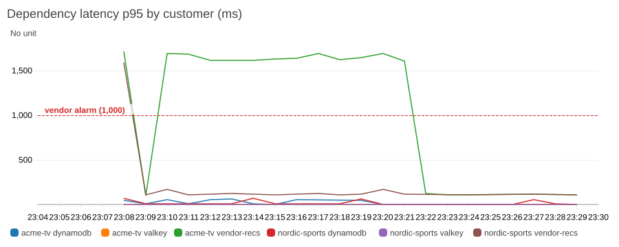
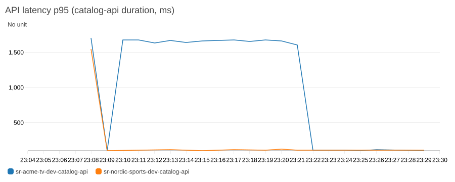
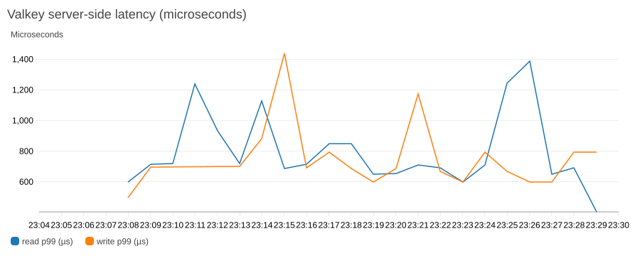

# Incident loop, recorded runs (fallback for the live demo)

## 19/11/2026: S1 with the new analysis (G3), issue #15: the escalation path

Scenario S1 on **dev** again, with the loop's code from main (case files and G3, ADR
0015). Started after a checked 15-minute quiet window (no apply, deploy or flags change).
Record: issue [#15](https://github.com/Anshul-exe/showrunner/issues/15) and the audit
table (`pk = acme-tv-dev-20261119T1250`). **#6 stays the demo fallback**: this run is the
record of what happens when the fix can't be measured.

| UTC | +s from alarm | Event |
|---|---|---|
| ~12:41 | | demo traffic starts (25 min) on acme-tv and nordic-sports |
| 12:50:31 | 0 | `sr-acme-tv-dev-api-latency` -> ALARM (1,725 and 1,619 ms) |
| 12:50:35 | +4 | issue #15 opened; `vendor-latency` joins at 12:50:38 |
| 12:50:49 | +18 | analysis + proposal A1 `vendor-fallback-on` posted |
| 13:06 | | the last demo request to acme-tv: **the traffic ran out** |
| 13:07:29 | +1,018 | `/approve A1` |
| 13:08:32 | +1,081 | fallback live (AppConfig `flags` #18, 6.4 s) |
| 13:14 | | alarms back to OK, only because missing data counts as "not breaching" |
| 13:18:41 | +1,690 | **escalation**: "the API p95 did not recover within 10 minutes" (there were no requests to measure) |
| 13:24-13:31 | | recovery **measured by hand**: 5 min of traffic to acme-tv (3 rps, 900 requests, 0 errors) with chaos and the fallback on: API p95 **28-41 ms** per minute (CloudWatch, server side) vs 1,610-1,725 ms during the incident; 0 vendor calls (cached recommendations) |
| 13:33 | | `./sr demo s1 stop` (chaos off, flags at defaults, #19/#20; undo row 13:34) |
| 13:48 | | resolution row (`resolve`, by the owner) written; #15 closed with the timeline |

**What G3 changed, and it worked:**
- **Real baseline, with counts:** vendor-recs 1,606 ms in the last 3 min (79 calls) vs
  112 ms, the median of 6 min before the alarm; API 1,618 ms (210 requests) vs 127 ms.
  H1 `vendor-recs` **CONFIRMED** by checks (points there; same order as the API's p95).
- **The change hypothesis is always checked:** the model offered H2 `config-change`; the
  check found no config change or deploy in effect in the 15 min before the alarm and
  **REFUTED** it. Before G3 this kind of hypothesis had no check (issue #7).
- **Wrong suspects ruled out with numbers:** valkey 2.2 ms (0.1% of the API's p95; the
  cache answers in 1.3 ms server side), DynamoDB 7.5 ms (0.5%).
- **2 model calls**: triage 1,540 + 157 tokens, verifier 1,602 + 191 tokens, $0.00027 in
  all. Evidence collection 7.7 s (14 items, incl. network and DNS).

**What it taught:** the recovery check looked only at p95. With no requests there was no
p95, and "no data" was read as "not recovered". Missing data is neither a recovery nor
a failure. Fixed (19/11/2026): the check reads the API's request count too and, with no
traffic, says "can't verify: no traffic since HH:MM" (label `unverified`); `sr demo s1
start` warns when the demo traffic ends within 20 minutes; the demo uses 40-minute
traffic. The same trap exists in production: a latency alarm with `notBreaching` goes
OK when traffic stops (see [the runbook](../../ops/runbooks/api-latency.md)).

Some minutes of the 13:24-13:31 check show up to 360 requests against 180 sent; no other
client of the operator's was running then. Not explained.

## 18/11/2026: the whole loop, issue #6 (the fallback for the demo)

Scenario S1 on **dev** (acme-tv's vendor +1,500 ms), traffic from 09:58 to 10:18 UTC at
2 rps (`./sr demo traffic --minutes 20`). Record: issue
[#6](https://github.com/Anshul-exe/showrunner/issues/6) (analysis, approval, execution
note, post-incident review) and the audit table (`pk = acme-tv-dev-20261118T1010`).

| UTC | +s from alarm | Event |
|---|---|---|
| 10:08:10 | -113 | `./sr demo s1 start`: AppConfig `chaos` deployment #13 |
| 10:10:03 | 0 | `sr-acme-tv-dev-vendor-latency` -> ALARM (2 of 3 minutes over 1 s: 1,657 and 1,612 ms) |
| 10:10:07 | +4 | issue #6 opened by the GitHub App |
| 10:10:15 | +13 | analysis + proposal A1 `vendor-fallback-on` posted: triage and verifier both on Nova Lite (triage 1,074 + 242 tokens) |
| 10:10:40 | +37 | `sr-acme-tv-dev-api-latency` -> ALARM, joined to #6 |
| 10:11:28 | +85 | the user comments `/approve A1` |
| 10:11:34 | +91 | approve.yml starts: job 1 (commenter's permission + CODEOWNERS, no cloud access) 25 s, job 2 (OIDC, send the decision) 24 s |
| 10:12:28 | +145 | act: AppConfig `flags` deployment #14 (`vendor_fallback: false -> true`) |
| 10:12:35 | +152 | **fallback live** (6.4 s), "executed" note on the issue |
| 10:15:36 | +333 | recovery check: API p95 32.5 and 31.8 ms in two complete minutes (was 1,620 ms) |
| 10:15:37 | +334 | **post-incident review posted, issue closed** |
| 10:20:28 | | `./sr demo s1 stop`: chaos back to defaults (#15) |
| 10:21:40 | | flags back to defaults (#16): the mitigation undone |

Where the 152 s went: 85 s waiting for a human (by design), 59 s for approve.yml (most of
it two fresh GitHub runners starting), 7 s to make the change. Recovery took ~3 minutes
after the flag because the check wants two complete clean minutes of API p95.

What the analysis said: H1 `vendor-recs` **CONFIRMED** by checks (1,612 ms vs 110 ms,
the median of 9 minutes before the alarm; same order as the API's 1,620 ms); `valkey`
**REFUTED** (2.4 ms client-side, 0.1% of the API's p95; server-side p99 1,025 µs);
`dynamodb` **REFUTED** (10 ms, 0.6%). The model also added H2 `lambda` and H3 `unknown`
(citing all the remaining evidence), both inconclusive with no check: padding, tightened
since (`ops/agents/triage.md`; comparison in [model-triage.md](model-triage.md)).

Seen in this run and fixed after it:
- the reset at 10:21:40 wasn't on the record. Now every operator change to `flags`
  checks whether it undid an incident's mitigation and, if so, writes an `undo` audit
  row and comments on the issue (closed or not). Backfilled for #6 with
  `./sr incident undo-check acme-tv` (comment at 10:47 UTC, deployment #16).
- the PIR's problem-management line counted the test runs ("fired 5 times in 30 days");
  incidents started by `sr demo` are now counted separately.

## 17/11/2026: first runs, issues #1 and #2

Run: 17/11/2026, 23:08–23:47 UTC on **dev**, scenario S1 (acme-tv's vendor +1,500 ms)
with `./sr demo traffic --minutes 25 --rps 3`. The record is on GitHub:
issue [#1](https://github.com/Anshul-exe/showrunner/issues/1) (first run, wrong, closed
with the reason) and issue [#2](https://github.com/Anshul-exe/showrunner/issues/2)
(after the fix). Times below are from the Step Functions history and the audit table.

## Timeline

| UTC | Event |
|---|---|
| 23:08:35 | traffic starts (both customers; first report 23:08:50). Meant as a 4-minute warm-up; it was ~1.5 min |
| 23:09:57 | `./sr demo s1 start`: chaos live in 8.2 s |
| 23:11:03 | `sr-acme-tv-dev-vendor-latency` -> ALARM (**66 s** after chaos), EventBridge starts the loop |
| 23:11:06 | issue #1 opened by the GitHub App (**3 s** after the alarm) |
| 23:11:14 | analysis posted: **wrong** (see below), no proposal |
| 23:11:40 | `sr-acme-tv-dev-api-latency` -> ALARM: **joined to #1**, not a new issue |
| 23:13–23:17 | fix found, tested, shipped with `./sr deploy incident` (lane 2, no Terraform) |
| 23:17:13 | loop re-driven with the same alarm event |
| 23:17:17 | issue #2 opened |
| 23:17:24 | analysis + proposal A1 `vendor-fallback-on` posted (**10.7 s** after the start): open 3.6 s, evidence 3.2 s, triage 1.5 s, verify 1.6 s |
| 23:47:23 | no `/approve` in 30 min (nobody was awake: by design the loop doesn't approve itself) -> **escalation**: comment, `escalated` label, SNS email; nothing changed |

Not in this run (done on 18/11, above): `/approve A1` -> act -> recovery check -> post-incident review. The
day-1 run measured the action itself: the flag deployed in 15 s and the first request
was served from the fallback 17 s later, recs p95 12.3 ms ([S1](S1.md)).

## What the analysis on #2 says (excerpt)

- **H1 `vendor-recs`: CONFIRMED** (decided by checks): p95 1,633 ms in the last 3 min vs
  250 ms *expected p95 (only 1 min of history before the alarm)*; same order of
  magnitude as the API's 1,656 ms.
- **`valkey`: REFUTED**: 2.1 ms client-side, 0.1% of the API's p95; *the cache itself
  answers in 1,238 µs (server-side p99)*.
- **`dynamodb`: REFUTED**: 6.9 ms, 0.4% of the API's p95.
- **A1** `vendor-fallback-on`: the exact AppConfig diff
  (`vendor_fallback: false -> true`), lane (runtime, no deploy), blast radius (one
  customer env, recommendations may be a few hours old), rollback.
- Triage heading: *deterministic rules (model unavailable: ValidationException:
  Operation not allowed)*: Bedrock isn't enabled on this account yet.

## Why #1 was wrong

Traffic had started only ~1.5 minutes before the chaos, so the "baseline" was a single
minute: the first minute of traffic, inflated by cold starts. Vendor p95 that minute
was 1,715 ms for acme-tv **and 1,590 ms for nordic-sports, which had no chaos**. Against
it, the slow vendor looked 1.2x slower and was refuted; and a rehearsal change from an
hour earlier, already reverted, "confirmed" a config-change hypothesis.

Fixes (incident functions v2, regression tests from these numbers):
- the baseline uses only minutes before the alarm's evaluation window and needs at
  least 3 of them (their median absorbs one cold minute); otherwise the documented
  expected p95, labelled as such in the issue
- a change counts only if it's in the 15 min before the alarm **and** still in effect
  (flags not at their defaults, or that code version is live)

The first note on #1 blamed the chaos minute; the per-customer graph below showed the
control customer spiking too. The note was corrected and says so.

## Pictures (CloudWatch, this window)

Per-dependency p95: the 23:08 spike on both customers is the cold start; from 23:10
only acme-tv's vendor is slow; it recovers at 23:22 when the chaos was turned off.

The service-level view: slow, and nothing on it says why.

Valkey server-side, in microseconds, flat through the incident:

Others: [dependency errors](incident/dependency-errors-by-customer-count-min.png),
[Lambda concurrency](incident/lambda-concurrency-account-quota-applies.png),
[Lambda errors](incident/lambda-errors.png),
[Valkey connections/ECPUs](incident/valkey-client-connections-and-ecpus.png).

## Known quirk

The incident ID comes from the customer, env and alarm time, so re-driving the loop
with the same alarm event (as at 23:17) writes to the same audit key as the first run.
Fine for an operator re-drive; a post-incident review would list both runs' steps.
